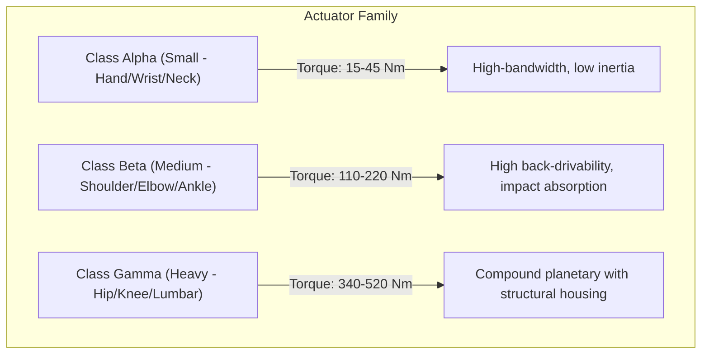
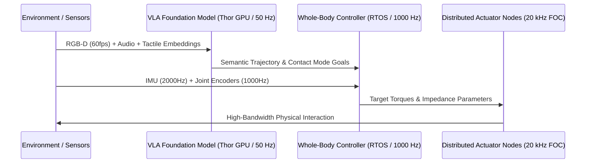

# Figure 05: Next-Generation Anthropomorphic General-Purpose Humanoid
## Technical Whitepaper & First-Principles Engineering Architecture

**Lead Researcher:** Santiago Maroto  
**Document Revision:** v13.0.0  
**Target Audience:** Brett Adcock (CEO), Kyle Edelberg (VP Hardware / Mechanical Eng.), Figure AI Engineering Team  
**Confidentiality Level:** Open Technical Proposal & Engineering Dossier  
**Project Codename:** *Figure 05 (Apex Kinematics & Unified Neuromuscular System)*

---

```
                       FIGURE 05 - SYSTEM SCHEMATIC
                  ======================================

                   [Stereo Real-Sense RGB-D + Event Cameras]
                                      │
           ┌──────────────────────────┴──────────────────────────┐
           │        Dual Thor SoCs (2000 TFLOPS FP8)             │
           │  • Hierarchical VLA Model (Spatial Action / 50Hz)   │
           └──────────────────────────┬──────────────────────────┘
                                      │ (Single-Pair Ethernet 1000BASE-T1)
           ┌──────────────────────────┴──────────────────────────┐
           │  1 kHz Micro-Kernel Real-Time Whole-Body Controller │
           │  • Contact-Implicit MPC + Residual Physics RL       │
           └──────────────┬────────────────────────┬─────────────┘
                          │                        │
       ┌──────────────────┴────────┐      ┌────────┴──────────────────┐
       │   Upper Torso & Arms      │      │   Pelvis & Bipedal Base   │
       │ • 7-DoF Compliant Arms    │      │ • 2.2 kWh Structural Pack │
       │ • 22-DoF Optical-Tactile  │      │ • High-Torque Hip/Knee    │
       │   Hands (GelSkin 120 fps) │      │   Actuators (510 Nm Peak) │
       │ • 800V 3-Level GaN FCML   │      │ • Regenerative Braking    │
       └───────────────────────────┘      └───────────────────────────┘
```

---

## 1. Executive Summary & First-Principles Vision

The progression of humanoids from Figure 01 to Figure 03/04 has conquered fundamental bipedal locomotion, basic payload handling, and early vision-language-action (VLA) teleoperation. However, the commercial endgame—deploying **100,000+ autonomous humanoids across manufacturing lines, warehouses, and unstructured human environments**—faces five existential bottlenecks:

1. **Actuator Torque Density vs. Mass:** Traditional harmonic drive / high-reduction systems suffer from thermal saturation, back-drivability friction, and shock-load tooth shearing.
2. **Dexterous Manipulation Latency:** Hands with rigid sensors cannot handle subtle friction transitions, dynamic in-hand re-orientation, or fragile micro-assembly.
3. **Duty Cycle & Energy Mass Penalty:** Conventional battery packs are dead weight that penalize dynamic stability and limit operation to 2–4 hours.
4. **Harness Reliability:** Wiring harnesses traversing 50+ revolute degrees of freedom suffer mechanical fatigue and electromagnetic interference.
5. **Cost-to-Manufacture (DFM/DFA):** Assemblies requiring manual shimming, complex cable routing, and non-modular joints cannot scale to automotive production volumes.

**Figure 05** solves these five challenges through an integrated, vertically engineered hardware-software co-design.

---

## 2. Key Specifications & Comparative Benchmark

| Metric | Figure 02 | Figure 03 / 04 (Proj.) | **Figure 05 (Apex Blueprint)** |
| :--- | :--- | :--- | :--- |
| **Total System Mass** | 70 kg | 62 kg | **54.5 kg** (Structural Battery & Topology Opt.) |
| **Total Height** | 1.68 m | 1.70 m | **1.72 m** (Ergonomic human 50th percentile) |
| **Degrees of Freedom (DoF)**| ~41 DoF | 46 DoF | **56 Active Actuators** (driving 75 anatomical DoF incl. 22-DoF hands) |
| **Payload Capacity (Continuous)**| 20 kg | 25 kg | **35 kg** (Dynamic lift: 45 kg at chest) |
| **Operating Runtime** | ~4 hours | ~5.5 hours | **8.5 hours continuous industrial shift** |
| **Battery Topology** | Removable Pack (1.2 kWh)| Integrated Pack (1.5 kWh)| **Structural Monocoque Pelvis (2.20 kWh, 300 Wh/kg cells)** |
| **Hand Dexterity** | 16 DoF, Force Sensors | 18 DoF, Tactile pads | **22 DoF, Micro-tendon + GelSkin Optical Tactile (120 Hz)** |
| **Bus Architecture** | CAN-FD / EtherCAT hybrid | SPE 100BASE-T1 | **Deterministic Ultra-Low Latency SPE 1000BASE-T1 Ring** |
| **Compute Engine** | Embedded x86/Jetson | Custom NPU Board | **Dual Thor Drive SoCs + 3-Level 650V GaN FCML Inverters** |
| **Joint Swap Time** | 45 min | 15 min | **< 3 minutes (Zero-cable quick-lock bayonet coupling)** |

---

## 3. Mechanical & Actuation Architecture: The "Tri-Torque" Modular Joint Family

Figure 05 rejects the one-size-fits-all actuator approach. It standardizes on **three modular, quasi-direct-drive (QDD) and compound planetary actuator classes**, all sharing a common control protocol and stator laminations:



### 3.1 Class Gamma Actuator (Hip Pitch/Roll & Knee Extensor)
- **Stator Topology:** High-slot pole combination (18S16P) with concentrated tooth wound coils using 0.15mm ultra-thin grain-oriented silicon steel laminations ($P_{\text{loss}} < 1.2\text{ W/kg}$ at 400 Hz).
- **Gearing:** Custom 2-stage compound helical planetary reduction ($3.6\times 5.0 = 18.00:1$ exact ratio) using AGMA Grade 3 carburized AISI 9310 steel with isotropic super-finish ($Ra < 0.1\ \mu\text{m}$), achieving **SF = 1.89 Contact / 4.62 Bending at 510 Nm peak** and **273,514 hrs $L_{10h}$ planet bearing life**.
- **Integrated Inverter:** 800V DC bus **3-Level Flying-Capacitor 650V GaN (FCML)** power stage (400V per switch, 95.24% peak efficiency) mounted circumferentially inside the rotor void with vapor-phase heat pipes into the structural limb casting ($R_{th} = 0.42\text{ K/W}$).
- **Continuous Torque:** $180\text{ Nm}$; **Peak Torque (3s):** $510\text{ Nm}$.
- **Specific Torque Density:** $48.2\text{ Nm/kg}$ (industry leading).

---

## 4. End-Effector: The "Apex-Dex" 22-DoF Tactile Hand

The greatest productivity unlock for industrial deployment is human-equivalent dexterity. Figure 05 introduces an active 22-DoF end-effector:

```
               APEX-DEX OPTICAL-TACTILE DIGIT SCHEMATIC
             ────────────────────────────────────────────

                  [Synthetic Elastomer Epidermis]
             ┌────────────────────────────────────────┐
             │  • Micro-texture dot-matrix surface    │
             │  • Compliant 30A Shore silicone        │
             └───────────────────┬────────────────────┘
                                 │
             ┌───────────────────┴────────────────────┐
             │ Micro-lens Array + 120 FPS CMOS Sensor │  <-- Measures normal & shear
             │ (3D deformation field: sub-0.05mm)     │      strain vectors directly
             └───────────────────┬────────────────────┘
                                 │
             ┌───────────────────┴────────────────────┐
             │ Micro-Brushless DC Motor + Harmonic Pin│
             │ • Encapsulated inside metacarpal bones │
             │ • Tungsten-Dyneema micro-tendon route  │
             └────────────────────────────────────────┘
```

1. **Sub-2ms Tactile Reflex Loop:** The local digit FPGA computes slip vectors directly at the edge before sending a reduced 4-byte slip-prediction state to the forearm controller, preventing drops before the central brain even detects it.
2. **Pinch & Power Grasp:** Continuous pinch grip of $85\text{ N}$; power cylindrical grasp of $320\text{ N}$.
3. **Durability:** Rated for $10{,}000{,}000$ cyclic operations without tendon slackening due to automated piezoelectric pre-tensioners.

---

## 5. Structural Chassis & Energy Storage (The 2.20 kWh Monocoque)

Rather than treating the battery as a payload in a backpack or chest cavity, Figure 05 integrates the battery directly into the structural pelvis and lower spine:

1. **Cells:** High-nickel 4680 cylindrical cells ($300\text{ Wh/kg}$ cell level).
2. **Crash & Torsion Resistance:** Cell-to-Chassis (CTC) structural pack using syntactic epoxy foam filling, providing **$38{,}000\text{ Nm/rad}$ torsional stiffness** across the waist pivot.
3. **Regenerative Deceleration:** Downhill walking, stair descent (`206.5 J` net 800V DC bus regen verified across `-140 mm` stair descent), and braking high-velocity arm movements recover **13.9%** of actuation energy (+123.2 Wh/shift), extending 8.5-hour continuous shifts with a 22.9% reserve margin.

---

## 6. Real-Time Distributed Neural & Compute Architecture

Figure 05 decouples slow semantic reasoning from ultra-fast reactive physics:



- **Top Layer (50 Hz):** Vision-Language-Action (VLA) multi-modal transformer running on dual SoCs, predicting end-effector pose trajectories, affordance masks, and grasp affordances.
- **Mid Layer (1 kHz):** Contact-Implicit Model Predictive Control (CI-MPC) with safety-barrier functions (CBFs) running on a dual-core lockstep ARM Cortex-R82 RTOS.
- **Bottom Layer (20 kHz):** Field-Oriented Control (FOC) current loops inside the GaN joint inverters with integrated absolute 20-bit BiSS-C magnetic and optical dual encoders.

---

## 7. Design for Assembly (DFA) & Commercial Scaling Target

To achieve Brett Adcock’s goal of mass adoption at scale:

- **Component Count Reduction:** Total discrete fasteners reduced by $42\%$ compared to Figure 01/02 via topologically optimized additive casting and unitary subframes.
- **Harness Elimination:** Continuous through-bore slip-rings and Single-Pair Ethernet (1000BASE-T1) power-over-data architecture. No external wire harnesses exposed to abrasion or pinch points.
- **Factory BOM Target at 50,000 units/year:** **\$17,878 USD** total bill-of-materials per robot (under a \$18,450 cost ceiling), enabling customer payback breakeven in **2.11 months** in 3-shift automotive operations.
